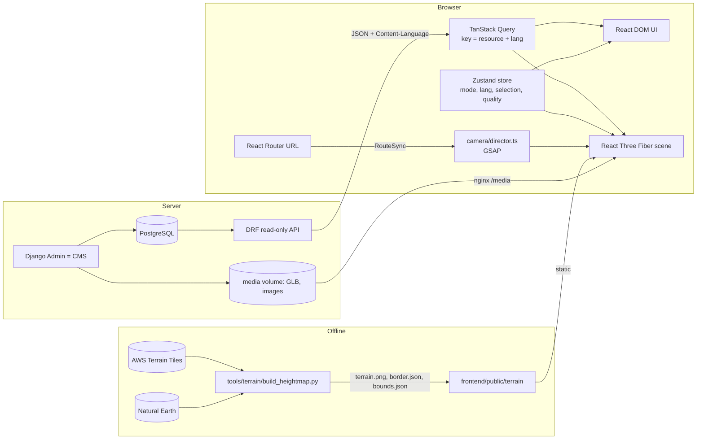
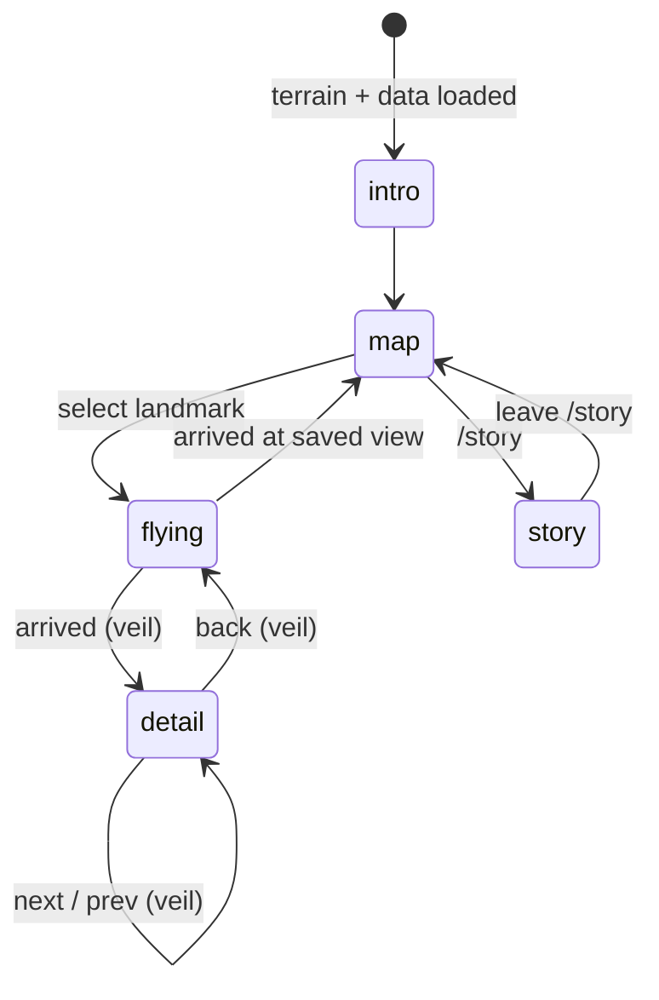

# Architecture — Tajikistan 3D

This document describes the **current** system and the **target** architecture the development plan moves towards. Decisions are recorded as ADRs. Each one names the alternatives that were rejected and the reasons.

---

## 1. System overview



**Principles**

1. **The URL is the source of truth** for what is on screen (`/place/:slug`, `/story`). `RouteSync` turns route changes into camera commands, so deep links, back/forward and sharing all work.
2. **Content never lives in React.** Landmark texts, categories, hotspots and eras come from the API in the active language. Only UI chrome labels (button captions) live in `src/i18n/strings.ts`.
3. **One persistent WebGL context.** The map scene is hidden, not unmounted, during a detail view. That avoids rebuilding the terrain (the most expensive object).
4. **Clear ownership of the camera** (ADR-5).

---

## 2. Backend

### Current

```
backend/
  config/settings/{base,dev,prod}.py   env-driven; SQLite fallback for quick start
  landmarks/                            single app
    models.py        Category, Landmark, LandmarkImage, Hotspot, LandmarkEra
    translation.py   modeltranslation registration (tg/ru/en)
    geo.py           projection contract (Python side)
    views.py         LanguageMixin + read-only ViewSets
    serializers.py   light list vs full detail
    admin.py         tabbed translations, inlines, content-status filter
    management/commands/seed_landmarks.py
```

### Target (Phase 1)

```
backend/
  config/
  apps/
    core/        projection (geo.py), language resolution, cache helpers, SitePage (About), health
    landmarks/   Category, Landmark, LandmarkImage, LandmarkModel, Hotspot, Era, HistoricalSource
    stories/     Story, StoryStep
```

**Planned model changes**

| Model | Change |
|---|---|
| `Landmark` | + `is_featured`, `area_geojson` (optional polygon for areas such as national parks), `coordinates_source` (where the coordinates were verified) |
| `LandmarkModel` *(new)* | `landmark`, `era?`, `file`, `lod` (high/medium/low), `size_bytes`, `credit`, `license`. Replaces `Landmark.model_file` and `LandmarkEra.model_file`, and enables LOD per quality tier. |
| `Hotspot` | + `image`, `history` (i18n), `camera_offset` (optional focus view) |
| `Era` (renamed from `LandmarkEra`) | + `is_reconstruction` (bool), M2M `sources`. Negative years stay BCE. |
| `HistoricalSource` *(new)* | `title`, `author`, `year`, `url`, `citation`. Linked from landmarks, eras and hotspots. |
| `Story`, `StoryStep` *(new)* | An ordered tour. Each step points at a landmark or a free camera keyframe, with i18n text and an optional image. |
| `SitePage` *(new)* | Editable "About Tajikistan" and similar pages (i18n). |

### API (target): `/api/v1/`, read-only, documented with drf-spectacular

| Endpoint | Purpose | Payload |
|---|---|---|
| `GET /api/v1/landmarks/map/` | Map markers | Light: slug, name, subtitle, category, lat/lon, position, camera. Unpaginated; bounded by the number of published landmarks. |
| `GET /api/v1/landmarks/` | Discover catalogue and search (`?search=`, `?category=`, `?featured=`) | Paginated cards |
| `GET /api/v1/landmarks/featured/` | Home highlights | Cards |
| `GET /api/v1/landmarks/nearby/?lat=&lon=&radius_km=` | "Nearby" | Cards + `distance_km` (haversine in SQL; no PostGIS) |
| `GET /api/v1/landmarks/{slug}/` | Detail | Full, including models per LOD |
| `GET /api/v1/landmarks/{slug}/eras/` | Time machine | Eras + sources |
| `GET /api/v1/landmarks/{slug}/stories/` | Stories containing this landmark | Story summaries |
| `GET /api/v1/stories/`, `/stories/{slug}/` | Story mode | Steps |
| `GET /api/v1/categories/` | Filters | Name and count |
| `GET /api/v1/schema/`, `/api/v1/docs/` | OpenAPI | |

Every response keeps `Content-Language`, `Vary: Accept-Language` and `Cache-Control`. The server side caches through the Django cache, with keys that include the language and a **content version** that is bumped by a `post_save` / `post_delete` signal, so admin edits show up immediately.

---

## 3. Frontend

```
frontend/src/
  api/          client.ts (fetch + errors), hooks.ts (TanStack Query), types.ts
  store/        useAppStore.ts (Zustand)
  i18n/         UI-chrome strings, locale-aware number/coordinate formatting
  lib/          geo.ts (projection, terrain loader), device.ts (quality tiers), dispose.ts
  three/
    Experience.tsx       Canvas, quality, post-processing (lazy chunk)
    camera/director.ts   every scripted camera move (GSAP)
    camera/CameraRig.tsx OrbitControls, limits per mode
    map/                 Terrain, Border, Markers, Atmosphere (+ Water, Globe in later phases)
    detail/              DetailStage, placeholders/, Hotspots
  ui/                    DOM overlays (header, map overlay, detail panel, story, 2D fallback)
  pages/                 (Phase 4+) Discover, History, Stories, About
```

### Scene state machine



---

## 4. Architecture decision records

### ADR-1: Translations as columns (django-modeltranslation), not separate translation tables
- **Decision:** keep `modeltranslation` (`name_tg`, `name_ru`, `name_en` …).
- **Why:**
  - There are exactly 3 fixed languages.
  - Reads need no joins and no N+1 queries.
  - Fallback tg → ru → en is built in.
  - The admin shows language tabs on one form.
  - The "missing translation" indicator is a simple column check.
- **Rejected:** `LandmarkTranslation` / `HotspotTranslation` tables, as suggested in the prompt. They give flexible language counts, but need a join or prefetch on every read, custom fallback logic and nested inlines in the admin.
- **Revisit if:** more than ~5 languages are needed, or languages must be added without a migration.

### ADR-2: Three Django apps, not one app per model
- `hotspots` and `eras` have no life of their own outside a landmark. Splitting them into separate apps would create cross-app foreign keys with no benefit. Stories *are* independent, so they get their own app. `core` holds shared, non-domain code.

### ADR-3: One projection contract, generated from one file
- **Decision:** `shared/projection.json` (bounds, map width, vertical exaggeration) becomes the single source:
  - `apps/core/geo.py` reads it;
  - `build_heightmap.py` reads it;
  - the frontend gets it through the generated `bounds.json`.
- Tests assert that identical lat/lon inputs give identical x/z in Python and TypeScript, using shared fixture points.

### ADR-4: Equirectangular projection with cosine correction
- At this scale (~700 × 520 km) the distortion is negligible. It is trivial to reproduce in Python and TypeScript, and the inverse is exact. Web Mercator is used only while reading source tiles.

### ADR-5: Camera ownership
- **OrbitControls** owns user input. **The director (GSAP)** owns scripted moves.
- While a scripted move runs, controls are disabled. Starting a new move kills the previous tween, so there is never more than one.
- The director saves the camera state before a fly-to and restores it on return.
- `gsap.ticker.lagSmoothing(0)` keeps moves on wall-clock time: slow devices skip frames instead of playing in slow motion.

### ADR-6: Terrain LOD with lazily loaded regional tiles
- The global heightmap (about 0.7 km/px) stays for the overview.
- For close-ups, a **regional high-resolution heightmap** (Terrarium zoom 11, about 60 m/px, roughly 40 × 40 km) is generated per landmark. It is loaded only when the camera flies there, and blended over the global mesh.
- Mesh building moves to a **Web Worker**.

### ADR-7: No PostGIS
- "Nearby" is a haversine expression over fewer than 1,000 rows, and area polygons are stored as GeoJSON for display only. PostGIS would add an operational dependency for no real gain at this size.
