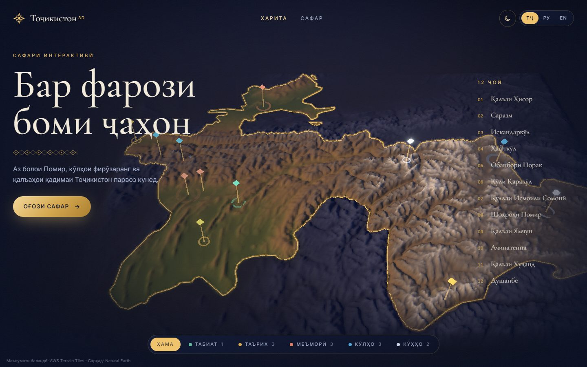
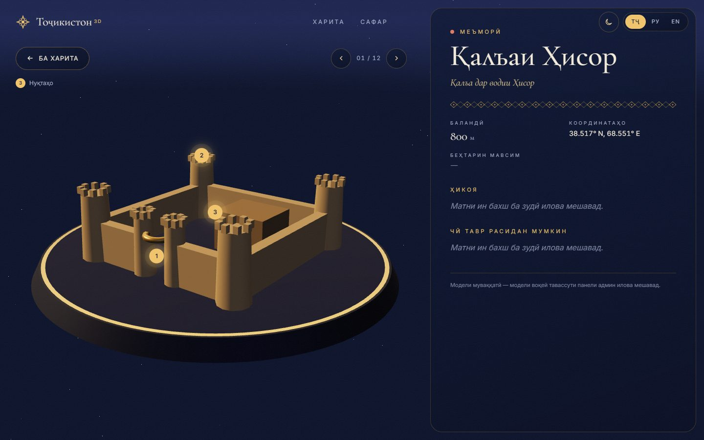
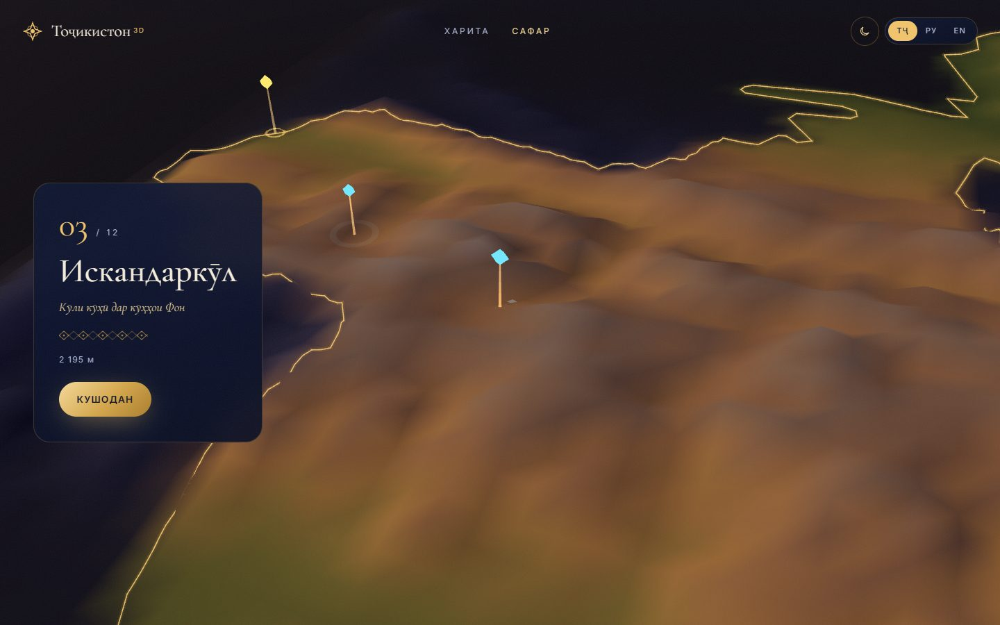
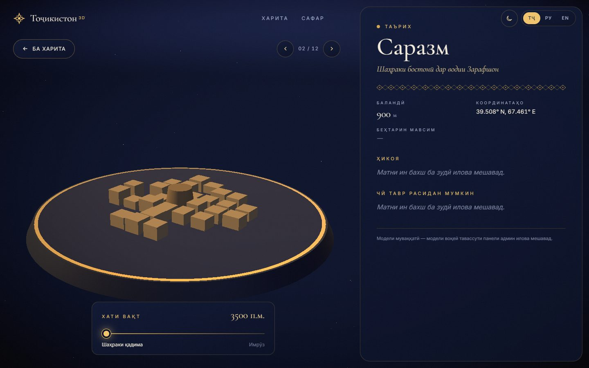
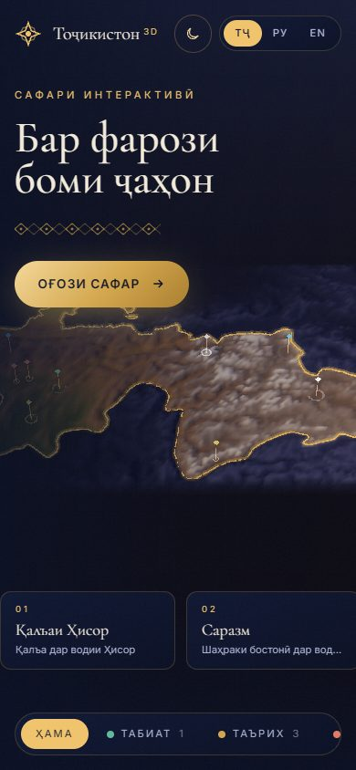

# Тоҷикистон 3D · Tajikistan 3D

An interactive, cinematic 3D journey over Tajikistan. Visitors fly over a real relief map of the country, click glowing landmarks, and the camera glides down to each place. There they can turn and zoom a 3D model, read its story and travel tips, and move through time on a slider.

**Stack:** Django 5 + DRF + PostgreSQL (the CMS is the Django admin) · React 19 + TypeScript + Vite · React Three Fiber, drei, postprocessing · GSAP ScrollTrigger · Zustand · TanStack Query · Tailwind CSS 4.

| Map | Landmark |
|---|---|
|  |  |
| **Story mode** | **Time slider** |
|  |  |

<p align="center">
  
  
</p>

---

## Features

- **Real terrain.** The relief comes from real elevation data (AWS Terrain Tiles, from SRTM and other sources) and is clipped to the country border from Natural Earth. Height is exaggerated 3× so the Pamirs read clearly. Tajikistan is coloured by height and slope, with snow on the high peaks, while neighbouring land fades to ink-blue. A gold border line follows every ridge.
- **Cinematic camera.** The intro drops in from orbit. Clicking a landmark starts an arcing fly-to, and an ornamental veil covers the switch to the landmark's own stage. "Back" reverses the whole sequence.
- **Landmark stage.** Each place gets a studio-lit plinth with a procedural HDRI (nothing to download), contact shadows, auto-rotate and numbered **hotspots**. It shows the uploaded GLB model, or a stylised procedural placeholder until one is uploaded.
- **Time slider.** Eras ("then / now") can each have their own model, or a ruined / restored placeholder variant.
- **Story mode.** Scrolling, scrubbed by GSAP ScrollTrigger, flies the camera along a smooth spline through every landmark.
- **Three languages.** Tajik (default), Russian and English. All content comes from the API (`?lang=` or `Accept-Language`), with fallback tg → ru → en.
- **Built for every device.**
  - Quality tiers (high / medium / low) are chosen from device signals and lowered automatically when the frame rate drops (`PerformanceMonitor`).
  - The low tier uses a half-resolution heightmap and turns off post-processing.
  - Phones without WebGL get an SVG **2D fallback**.
  - `?quality=low|medium|high` forces a tier for testing.
- **Deep links.** `/place/iskandarkul` and `/story` work directly, and the browser back button works.
- **Accessibility.** Keyboard navigation (← → Esc in the detail view), focus rings, `prefers-reduced-motion` and ARIA labels.

## Project structure

```
backend/                 Django project
  config/settings/       base / dev / prod
  landmarks/             models, admin, API, seed command, tests
    geo.py               lat/lon → 3D map projection (shared contract)
frontend/
  public/terrain/        generated heightmap + border + bounds.json
  src/api/               typed API client + TanStack Query hooks
  src/store/             Zustand app state (mode, language, selection…)
  src/three/             3D: map/, detail/, camera/director.ts, Experience.tsx
  src/ui/                DOM UI: header, overlays, detail panel, story, 2D fallback
tools/terrain/           build_heightmap.py (regenerates the terrain assets)
docker-compose.yml       postgres + gunicorn + nginx
```

**Data flow:** Django admin → PostgreSQL → read-only DRF API → TanStack Query (the query key includes the language) → React. The URL is the source of truth for the selected landmark. `RouteSync` turns route changes into camera moves in `director.ts`.

## Quick start (development)

Requirements: Python 3.12+ and Node 20+.

```bash
# 1. Backend (SQLite by default; set POSTGRES_* env vars to use PostgreSQL)
cd backend
python -m venv .venv
.venv/Scripts/activate            # Windows  (source .venv/bin/activate on macOS/Linux)
pip install -r requirements.txt
python manage.py migrate
python manage.py seed_landmarks   # 5 categories + 12 landmarks
python manage.py createsuperuser
python manage.py runserver        # http://127.0.0.1:8000/admin/

# 2. Frontend (second terminal)
cd frontend
npm install
npm run dev                       # http://localhost:5173
```

Vite proxies `/api`, `/media` and `/admin` to Django, so everything runs on one origin.

Tests and checks:

```bash
cd backend && python manage.py test landmarks
cd frontend && npm run typecheck && npm run build
```

## Production (Docker)

```bash
cp .env.example .env          # set DJANGO_SECRET_KEY, POSTGRES_PASSWORD, admin password, hosts
docker compose up --build -d
# site:  http://localhost:8080      admin: http://localhost:8080/admin/
```

- `backend` runs migrations and the seed command on start (both idempotent), then gunicorn.
- `web` is nginx. It serves the built SPA with immutable caching for hashed assets, serves `/media/` (models, photos) directly from a shared volume with the right `model/gltf-binary` MIME type, and proxies `/api` and `/admin` to Django.
- Behind HTTPS, set `DJANGO_SECURE_COOKIES=1`, `DJANGO_SSL_REDIRECT=1`, `DJANGO_HSTS_SECONDS=31536000`, and add your domain to `DJANGO_ALLOWED_HOSTS`, `CSRF_TRUSTED_ORIGINS` and `CORS_ALLOWED_ORIGINS`.

## API

| Endpoint | Description |
|---|---|
| `GET /api/landmarks/?lang=ru&category=lakes` | Published landmarks (light payload for the map) |
| `GET /api/landmarks/<slug>/?lang=en` | Full landmark: texts, images, hotspots, eras |
| `GET /api/categories/?lang=tg` | Categories with published landmark counts |

Read-only. Responses carry `Content-Language` and `Vary: Accept-Language`, and are cacheable for 60 s.

## Content workflow (admin)

1. Open **Landmarks** and use the filter **content status → Needs text**. The "Missing texts" column counts empty translations.
2. Each text field has **tg / ru / en** tabs. The seed data contains only names, short taglines and *approximate* coordinates. **Historical texts are intentionally empty — write and verify them yourself.**
3. **Images** and **hotspots** are inline. Hotspot x/y/z are in the model's local space: the plinth is about 8 units across and the model is fitted to about 5 units.
4. **Eras** feed the time slider. Use a negative year for BCE (e.g. `-3500`).
5. Coordinates update the marker position automatically. Under **Fly-to camera** you can tick `camera_override` to set a custom view.

## Preparing 3D models

The site accepts **GLB** files (max 15 MB; aim for **under 5 MB**). Upload one on a landmark (or era) and it replaces the placeholder. It is centred and scaled to the plinth automatically; adjust `model_scale` if needed.

1. **Capture (photogrammetry).** Use **Polycam** or **RealityScan** on a phone, or drone photos.
   - Walk around the site at 2–3 heights with 70–80 % overlap between photos.
   - Shoot under overcast light (no hard shadows), and skip reflective or moving things.
   - Get written permission where it is required, especially for drone flights near monuments.
2. **Clean up in Blender.**
   - Import the OBJ/GLB, delete stray geometry, and close holes.
   - Put the base on Z = 0 and point the front of the site at +Y (the viewer's front).
   - Decimate to about 100–300k triangles (*Modifiers → Decimate*).
   - Bake or keep **one 2048² (4096² at most) texture**.
   - Export with *File → Export → glTF 2.0*, format **GLB**, +Y up.
3. **Compress with gltf-transform:**

   ```bash
   npx @gltf-transform/cli optimize input.glb output.glb \
       --compress draco --texture-compress ktx2 --texture-size 2048
   # or meshopt instead of draco:  --compress meshopt
   ```

   Draco, meshopt and KTX2 decoders are served locally from `/decoders/`. They are copied from three.js on `npm install`.
4. **Check** the result in <https://gltf-viewer.donmccurdy.com/> before uploading.

Free models (e.g. Sketchfab) are fine if the licence allows it. Put the author and licence in **model credit**.

## Rebuilding the terrain

```bash
python -m venv tools/.venv && tools/.venv/Scripts/pip install -r tools/terrain/requirements.txt
tools/.venv/Scripts/python tools/terrain/build_heightmap.py
```

The script downloads about 40 elevation tiles and the Natural Earth border. It writes `terrain.png` (R/G = 16-bit height, B = country mask), `terrain-low.png`, `border.json` and `bounds.json`. The projection constants live in three places that must stay in sync: `backend/landmarks/geo.py`, the script, and `bounds.json`. A backend test checks this.

## Credits

- Elevation: [AWS Terrain Tiles](https://registry.opendata.aws/terrain-tiles/), from SRTM, GMTED, ETOPO1 and others.
- Country border: [Natural Earth](https://www.naturalearthdata.com/) (public domain).
- Fonts: Cormorant Garamond and Inter (SIL Open Font License).
