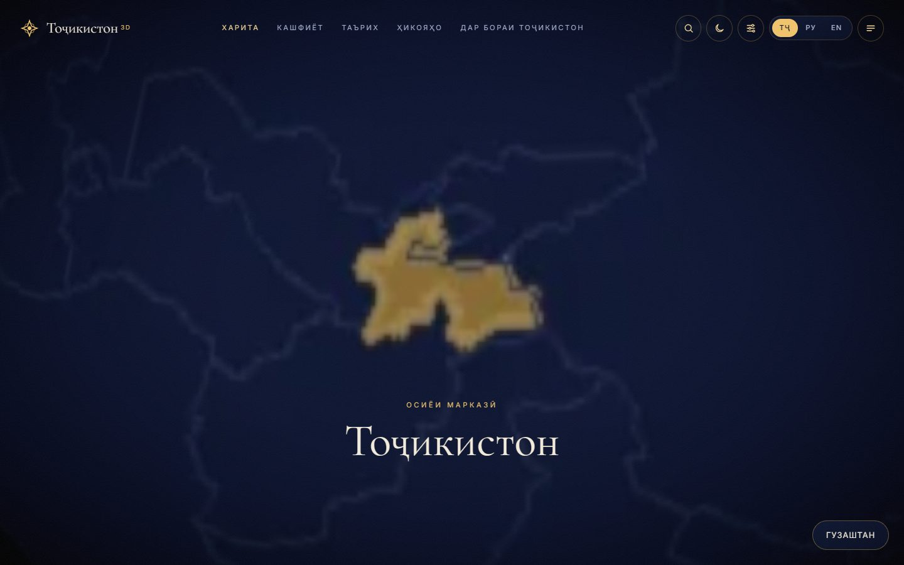
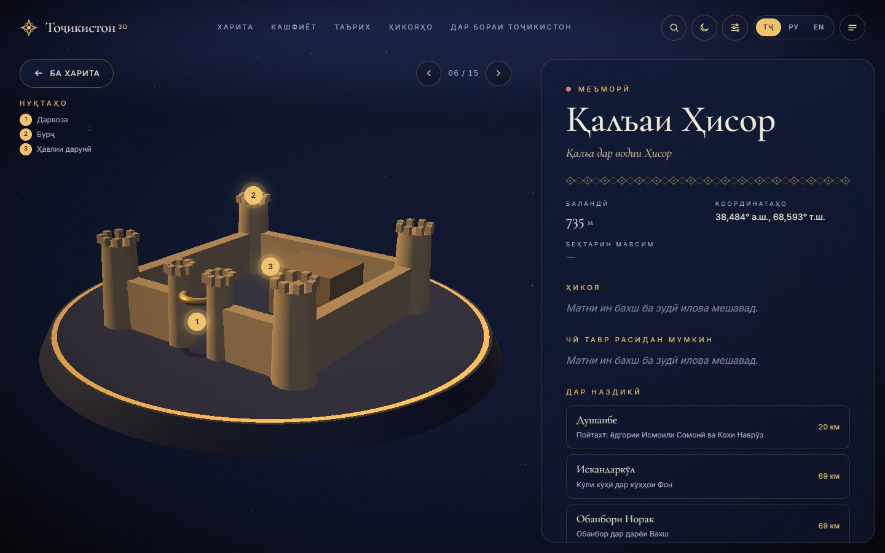
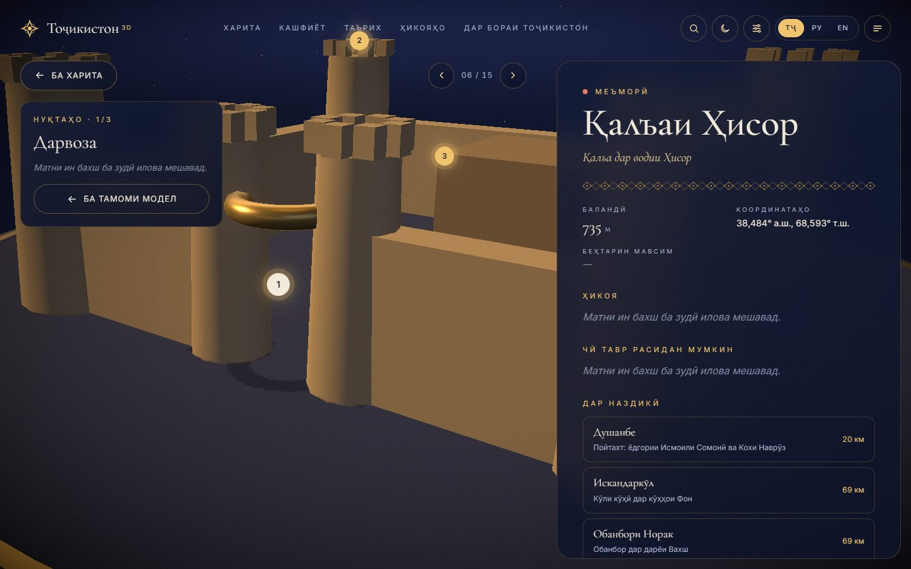
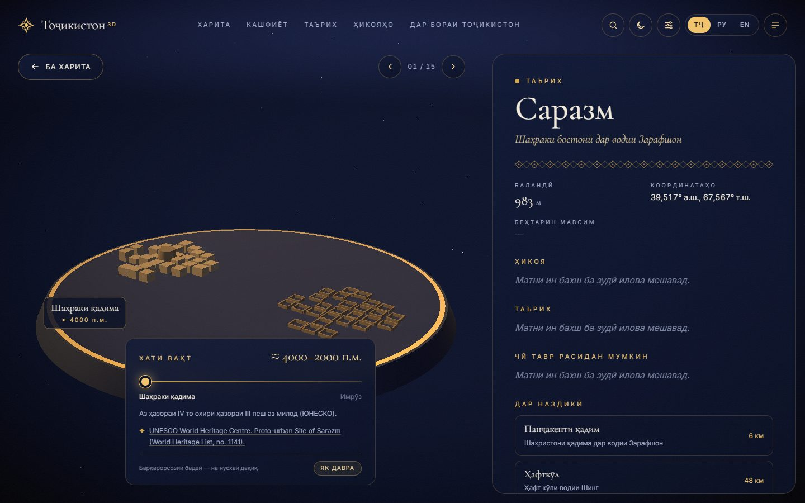
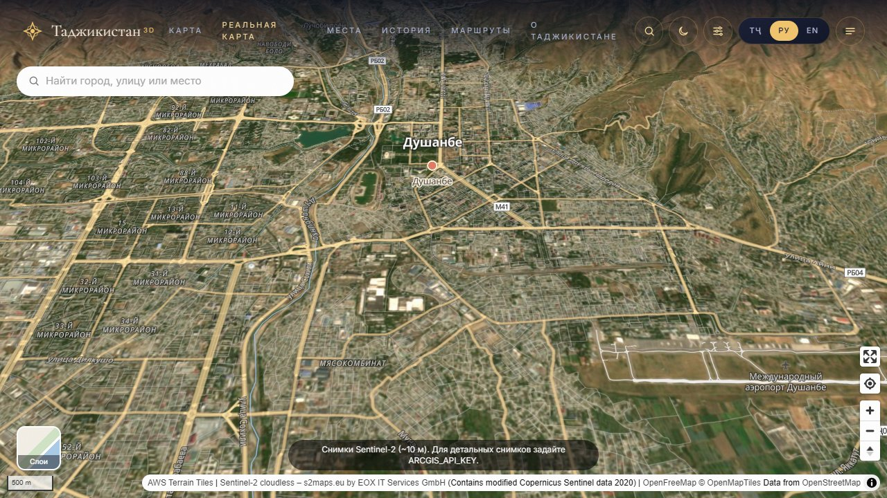
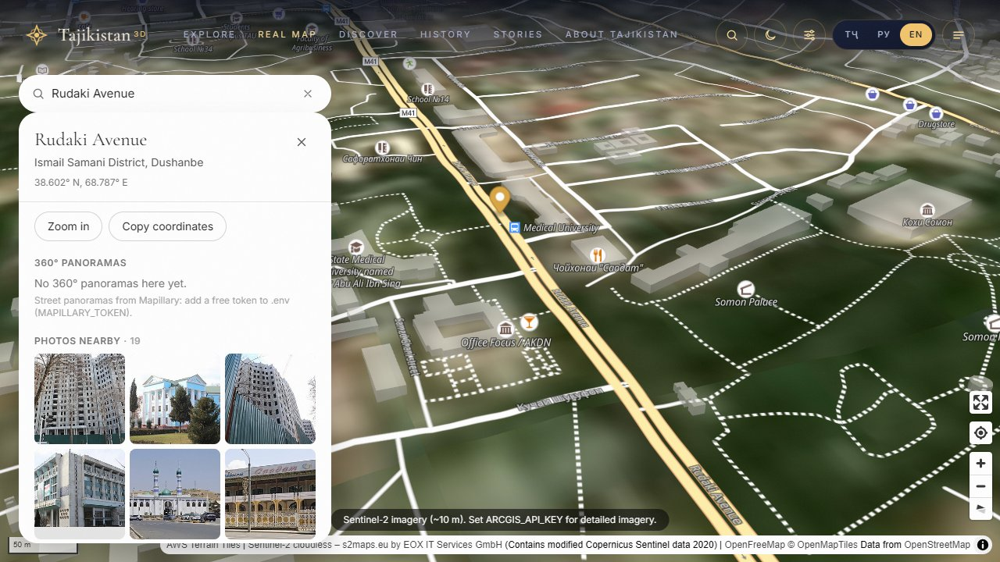

# Тоҷикистон 3D · Tajikistan 3D

**Explore the land. Discover the history. Experience Tajikistan.**

An immersive WebGL platform for exploring Tajikistan. It opens from space over Central Asia and descends onto a real relief map of the country built from elevation data. Click a landmark and the camera flies there and opens the landmark's own 3D stage, which has hotspots, a historical time machine, sources and travel information. Everything is available in Tajik, Russian and English, and all content is managed in the Django admin.


| Intro from space | Landmark stage | Hotspot focus |
|---|---|---|
|  |  |  |
| **Time machine (before / after)** | **Story mode** | **Mobile** |
|  |  |  |

| **Real map: satellite, 3D relief, every street** | **Any place: address, photos, 360°** |
|---|---|
|  |  |

## What is inside

| Area | Highlights |
|---|---|
| **Real map** (`/map`) | Every road, building and place from OpenStreetMap. Satellite hybrid mode with 3D relief, 3D buildings and a globe. Search for any street or place in Tajikistan, and "what is here" with the address at any click. Openly licensed photos and 360° panoramas around any point, with author and licence. Opens from any landmark, and every view is a shareable link. |
| **Real terrain** | AWS Terrain Tiles (zoom 9), border from Natural Earth, lakes and rivers from OpenStreetMap. Baked hillshade, snow that depends on slope and aspect, 3D lake surfaces at their real level. Detail patches of about 90 m/px stream in around each landmark. One projection contract shared by Python and TypeScript and covered by tests on both sides. |
| **Camera director** | Intro from space, descent, arcing fly-to, map ↔ stage behind an ornamental veil, return to the saved view, hotspot focus, a scroll-driven story spline. Only one move runs at a time. |
| **Landmark stage** | Uploaded GLB (Draco, meshopt, KTX2; one LOD per quality tier) or a procedural placeholder. Auto-fit, studio lighting, contact shadows, hotspots, gallery, sources, a "Nearby" list. |
| **Time machine** | Eras with BCE years and ranges, sources, an "illustrative reconstruction" badge and a side-by-side comparison. |
| **CMS** | Django admin: inline translations (tg/ru/en), hotspots, eras, 3D models with sizes, citations, a story editor, missing-translation indicators, coordinate sources. |
| **API v1** | Read-only, OpenAPI at `/api/v1/docs/`. Endpoints: map, paginated search, featured, nearby, eras, stories, pages. Server cache that is invalidated the moment content is saved. |
| **Performance** | Lazy 3D chunk (the 2D fallback never downloads three.js), Web Worker meshing, instanced markers, three quality tiers with automatic downgrade, SVG 2D fallback. See [docs/development/performance.md](docs/development/performance.md). |
| **Accessibility** | Keyboard routes to every landmark and hotspot, skip link, ARIA labels, `prefers-reduced-motion`, Ctrl+K search that understands Tajik letters. |

## Documentation

- [ARCHITECTURE.md](ARCHITECTURE.md): system design, data flow, decision records (ADRs).
- [DEVELOPMENT_PLAN.md](DEVELOPMENT_PLAN.md): phases and what is done.
- [TECHNICAL_AUDIT.md](TECHNICAL_AUDIT.md): the Phase 0 audit and how each finding was resolved.
- [docs/development/deployment.md](docs/development/deployment.md): Docker, HTTPS, backups, monitoring.
- [docs/development/performance.md](docs/development/performance.md): measured bundle, terrain and renderer numbers.

## Quick start (Windows / PowerShell)

Requirements: Python 3.12+ and Node 20+ (Node 24 is used in CI).

```powershell
# 1. Backend — SQLite by default; set POSTGRES_* variables to use PostgreSQL
cd backend
python -m venv .venv
.venv\Scripts\Activate.ps1
pip install -r requirements.txt
python manage.py migrate
python manage.py seed_landmarks      # 5 categories, 15 landmarks, 1 story, About page
python manage.py createsuperuser
python manage.py runserver           # API: http://127.0.0.1:8000/api/v1/docs/

# 2. Frontend — in a second terminal
cd frontend
npm install
npm run dev                          # http://localhost:5173  (proxies /api, /media, /admin)
```

Useful URLs:
- `/?quality=low|medium|high` forces a rendering tier.
- `/?webgl=0` shows the 2D interface.
- `/?debug` exposes renderer statistics in `window.__TJ3D__`.
- `/place/<slug>?pick=1` prints the model coordinates of a click, ready to paste into the hotspot form in the admin.

## Real map: satellite imagery and 360° panoramas

The real map works with no keys at all. Two optional free keys in `.env` make it better:

| Variable | What it adds | Where to get it |
|---|---|---|
| `ARCGIS_API_KEY` | High-resolution satellite imagery (Esri World Imagery, under 1 m in cities). Without it the satellite layer is Sentinel‑2 cloudless (about 10 m/px, CC BY-NC-SA 4.0), which is sharp for mountains and blurry for streets. | https://location.arcgis.com/: free tier, create an API key with the *basemaps* privilege |
| `MAPILLARY_TOKEN` | Street-level photos and 360° street panoramas. Adds a "Street panoramas" layer: click a blue line to see the street. | https://www.mapillary.com/dashboard/developers: register an app and copy the *client token* |

Restart the backend after editing `.env`. The browser reads both keys from `/api/v1/map-config/` at runtime, so the frontend does not need a rebuild.

Where the data comes from:
- Map: [OpenFreeMap](https://openfreemap.org) (OpenStreetMap, OpenMapTiles schema).
- Search and addresses: [Photon](https://photon.komoot.io).
- Relief: AWS Terrain Tiles.
- Photos and panoramas: `/api/v1/nearby-media/`, which queries Wikimedia Commons, Panoramax and Mapillary on the server and caches the result for 6 hours.

Images are shown with their author and licence and link to their source page. Open 360° coverage of Tajikistan is still small: Commons has almost no geotagged spheres there, and Panoramax has only single shots. Mapillary is the main source.

## Tests

```powershell
cd backend;  .venv\Scripts\python manage.py test          # 56 tests: API, serializers, fallback, uploads, projection, cache, nearby media
cd frontend; npm run typecheck; npm test; npm run build   # Vitest: projection contract, mesh builder, search, real-map style
cd frontend; $env:PW_CHANNEL="msedge"; npm run e2e        # Playwright: 12 end-to-end flows (starts both servers; the real-map ones need internet)
```

To run the end-to-end suite against an already running deployment, set `$env:E2E_BASE_URL="http://localhost:8080"`. GitHub Actions runs all of it on every push (`.github/workflows/ci.yml`).

## Production

```powershell
Copy-Item .env.example .env   # set secrets and hosts
docker compose up --build -d  # http://localhost:8080
```

That brings up PostgreSQL, gunicorn, nginx and daily backups. HTTPS on a domain uses `docker-compose.prod.yml` (Caddy with automatic certificates). Restore, monitoring and the security checklist are in [docs/development/deployment.md](docs/development/deployment.md).

## Adding content

1. **Admin → Landmarks.** The "content status" filter shows what still needs text, a model or sources. Every text field has tg / ru / en tabs, and empty translations fall back tg → ru → en.
2. **Coordinates.** Verify them (for example on Wikidata) and record the source in *coordinates source*. The marker position and fly-to camera are calculated automatically.
3. **History.** Write only verified facts and attach **Historical sources**. Eras use negative years for BCE. 3D models are flagged *illustrative* by default, and the site shows that badge.
4. **3D models.** Upload them inline as GLB, one per LOD (high / medium / low). See *Preparing 3D models* below.
5. **Stories.** Admin → Stories → steps, each either a landmark or a free camera keyframe. The *default* story opens from "Start the journey".

> The seed data contains names, taglines and coordinates verified against Wikidata. The one historical statement in it, Sarazm's dating, is quoted from its UNESCO listing with the source attached. **All other historical and travel texts are intentionally empty**, waiting for verified content.

## Preparing 3D models

1. **Capture.** Photogrammetry with Polycam or RealityScan, or drone photos.
   - Walk around the site at 2–3 heights with 70–80 % overlap.
   - Shoot under overcast light.
   - Get the permissions required for monuments and drones.
2. **Clean up in Blender.**
   - Delete stray geometry and close holes.
   - Put the base at Z = 0, with the front facing +Y.
   - Decimate to about 100–300k triangles (high), about 50k (medium) and about 15k (low).
   - Bake one 2048² texture.
   - Export glTF 2.0 as **GLB**.
3. **Compress:**

   ```powershell
   npx @gltf-transform/cli optimize input.glb output.glb --compress draco --texture-compress ktx2 --texture-size 2048
   ```

4. **Check** the result at https://gltf-viewer.donmccurdy.com/, then upload. The admin rejects anything that is not a binary glTF 2.0 file or is over 15 MB, and it shows the size in green when the file is at most 5 MB.

The model is centred and scaled onto the stage automatically. Hotspot coordinates are in the model's own space, exactly as in Blender.

## Rebuilding the terrain

```powershell
python -m venv tools\.venv
tools\.venv\Scripts\pip install -r tools\terrain\requirements.txt
tools\.venv\Scripts\python tools\terrain\build_heightmap.py   # reads landmarks from the running API
```

## Credits

- Elevation: [AWS Terrain Tiles](https://registry.opendata.aws/terrain-tiles/), from SRTM, GMTED, ETOPO1 and others.
- Borders, land, some lakes and rivers: [Natural Earth](https://www.naturalearthdata.com/) (public domain).
- Lakes and rivers: © [OpenStreetMap](https://www.openstreetmap.org/copyright) contributors, ODbL.
- Coordinates: [Wikidata](https://www.wikidata.org/) (CC0). Sarazm dating: [UNESCO World Heritage Centre](https://whc.unesco.org/en/list/1141/).
- Real map: © OpenStreetMap contributors (ODbL) via OpenFreeMap / OpenMapTiles; geocoding by Photon (komoot); satellite: Sentinel‑2 cloudless by EOX (CC BY-NC-SA 4.0) or Esri World Imagery with a key; photos: Wikimedia Commons, Panoramax, Mapillary (each with its own author and licence).
- Fonts: Cormorant Garamond and Inter (SIL Open Font License). Ambient sound is synthesised in the browser, with no audio files.
